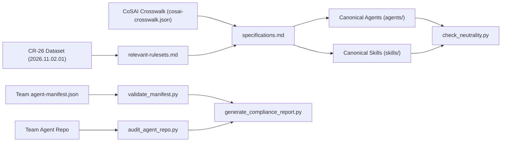

# fedramp-agent

**Enterprise Standard Repository for FedRAMP Consolidated Rules 2026 (CR-26) Compliant AI Agents**

> [!IMPORTANT]
> **Imminent CR-26 & CISA BOD 26-04 Deadlines (Analysis Date: 2026-11-19 | Dataset: CR-26 `2026.11.02.01`, updated `2026-11-02`)**
> - **2026-12-07:** CISA BOD 26-04 mandates **VDR** (Vulnerability Detection & Response) and **VER** (Vulnerability Exposure & Remediation) adoption (grace period ends **2027-03-07**).
> - **2027-01-01:** **CR-26 Mandatory Adoption** across FedRAMP offerings.
> - **2027-06-11:** **End of New Rev5 Certifications** (transition to `20x` required for new certifications).

Hundreds of engineering teams build AI agents for FedRAMP **Class C** and **Class D** Cloud Service Offerings (CSOs). Without a shared standard, teams invent ad-hoc boundaries, leak telemetry, misconfigure FIPS/identity controls, or miss Third-Party Information Resource (TPIR) disclosures. **`fedramp-agent`** is the authoritative enterprise template and validation standard that teams clone, branch from, and validate against so agents never break FedRAMP compliance.

---

## Navigation: Humans vs. AI Agents

| Audience | Start Here | Primary Purpose |
| :--- | :--- | :--- |
| **Human Engineers & Leads** | [docs/getting-started.md](docs/getting-started.md) | Day-0 to Day-N onboarding, profile selection, boundary setup, and CI validation |
| **Human Architects & Reviewers** | [specifications.md](specifications.md) | Polyglot architecture, CoSAI Risk Map alignment, and control enforcement patterns |
| **Human Governance & Compliance** | [relevant-rulesets.md](relevant-rulesets.md) | Full CR-26 rule-by-rule applicability (`20x` & `Rev5`, Class C & Class D) |
| **Human & Org Routing Leads** | [docs/model-routing-playbook.md](docs/model-routing-playbook.md) | Multi-model subscription routing, quotas, and CSO inference boundary rules |
| **AI Coding & Review Agents** | [llms.txt](llms.txt) → [AGENTS.md](AGENTS.md) | Machine-parsable index, mandatory read order, and non-negotiable compliance invariants |
| **Contributors** | [CONTRIBUTING.md](CONTRIBUTING.md) | Fork/branch workflow, SCN change classification, pre-commit gates, and commit trailers |

---

## Architecture Overview

`fedramp-agent` separates **polyglot, vendor-neutral specifications** from **zero-dependency Python 3.11+ compliance tooling**, following the Coalition for Secure AI (CoSAI) Risk Map patterns (ADR-006, ADR-030, ADR-033):



### Supported Agent Profiles

| Profile | Scope & Deployment | Primary Compliance Focus |
| :--- | :--- | :--- |
| **`runtime-cso`** | Deployed inside the FedRAMP CSO boundary handling Federal Customer Data or in-scope metadata | Strict `MAS` boundary, `CMU-CSO-UVM` (FIPS), `CTL.IA.IA-05`, `CTL.SA.SA-09-05` (residency), `MAS-CSO-TPR` (TPIRs), telemetry scrubbing, `VDR`/`VER` SLAs |
| **`internal-devsecops`** | Internal engineering, platform, CI/CD, or compliance agents operating on CSO code/configs | Change classification (`SCN`), `SDR` evidence generation, `check_neutrality.py`, no raw Federal data exfiltration, `CPO` / `CCM` governance |

---

## Class C vs. Class D Compliance Summary

`fedramp-agent` covers **both `20x` and `Rev5`** (Class C on `20x` & `Rev5`; Class D on `Rev5` + `20x`-ready for 2027):

| Rule / Control | Class C | Class D | Notes |
| :--- | :--- | :--- | :--- |
| **`CMU-CSO-UVM`** (Crypto) | `SHOULD` use active FIPS-validated modules | `MUST` use active FIPS-validated modules | Enforced by `validate_manifest.py` |
| **`CDS-CSO-PSM`** (Certification Docs) | `MAY` supply per-service FedRAMP materials | `MUST` supply per-service FedRAMP materials | Required artifacts checked in manifest |
| **`CTL.IA.IA-05`** (Identity / SSO) | `IAL2` / `AAL2` / `FAL2` | `IAL3` / `AAL3` / `FAL3` + encrypted SAML XML-Enc / OIDC JWE | Hard gate for Class D `runtime-cso` |
| **`CTL.SA.SA-09-05`** (Residency) | Standard external service controls | Explicit U.S. / U.S. Territories / U.S. jurisdiction residency | Covers all Federal data, processing, and services |
| **`VER-TFR-EVU`** (Vuln Triage) | `5-day` vulnerability triage SLA | `2-day` vulnerability triage SLA | Aligned with CISA BOD 26-04 (`2026-12-07`) |
| **`VER-TFR-NRI`** (Non-Internet Findings) | `MAY` treat likely exploitable findings as incidents | `SHOULD` treat likely exploitable findings as incidents | Reflected in `templates/VDR-vulnerability-profile.md` |
| **Pending `20x` Class D KSIs** | Defined in CR-26 `2026.11.02.01` | **Omitted** in `2026.11.02.01` (`20x` Class D coming 2027) | Applies to `KSI-CNA-EIS`, `KSI-MLA-ALA`, `KSI-SVC-PRR`, `KSI-SVC-RUD`, `KSI-SVC-VCM`, and `VDR-TFR-MVX` — **never invent missing variants** |

---

## Quickstart: Clone, Branch & Validate

1. **Clone or use this repository as your upstream template:**
   ```bash
   git clone <your-org>/fedramp-agent.git my-team-agent
   cd my-team-agent
   git checkout -b feat/my-agent-profile
   ```
2. **Choose a profile** (`runtime-cso` or `internal-devsecops`) and copy the matching example manifest from [templates/agent-manifest.example.class-c.json](templates/agent-manifest.example.class-c.json) or [templates/agent-manifest.example.class-d.json](templates/agent-manifest.example.class-d.json) to `agent-manifest.json`.
3. **Run the zero-dependency Python 3.11+ compliance gates:**
   ```bash
   python3 tools/validate_manifest.py templates/agent-manifest.example.class-c.json
   python3 tools/validate_manifest.py templates/agent-manifest.example.class-d.json
   python3 tools/check_neutrality.py agents skills
   python3 tools/audit_agent_repo.py --repo . --manifest templates/agent-manifest.example.class-d.json
   python3 tools/generate_compliance_report.py --manifest templates/agent-manifest.example.class-d.json --md-out compliance-report.md --json-out compliance-report.json
   python3 -m unittest discover -s tests -v
   ```

For the full Day-0 to Day-N walkthrough, see [docs/getting-started.md](docs/getting-started.md).

---

## Repository Structure

- **Core Governance & Specs:** [AGENTS.md](AGENTS.md), [llms.txt](llms.txt), [relevant-rulesets.md](relevant-rulesets.md), [specifications.md](specifications.md), [CONTRIBUTING.md](CONTRIBUTING.md)
- **Compliance Crosswalks & Glossary:** [compliance/sources-manifest.json](compliance/sources-manifest.json), [compliance/frd-glossary.md](compliance/frd-glossary.md), [compliance/marketplace-class-cd-analysis.md](compliance/marketplace-class-cd-analysis.md), [compliance/cosai-crosswalk.md](compliance/cosai-crosswalk.md), [compliance/cosai-crosswalk.json](compliance/cosai-crosswalk.json)
- **Canonical Agents & Skills:** [agents/README.md](agents/README.md), [skills/README.md](skills/README.md)
- **JSON Schemas:** [schemas/agent-manifest.schema.json](schemas/agent-manifest.schema.json), [schemas/sdr-agent-addendum.schema.json](schemas/sdr-agent-addendum.schema.json), [schemas/scn-record.schema.json](schemas/scn-record.schema.json), [schemas/tpir-register.schema.json](schemas/tpir-register.schema.json), [schemas/evidence-bundle.schema.json](schemas/evidence-bundle.schema.json)
- **Templates:** [templates/MAS-boundary-statement.md](templates/MAS-boundary-statement.md), [templates/SDR-agent-record.md](templates/SDR-agent-record.md), [templates/SCG-agent-secure-config.md](templates/SCG-agent-secure-config.md), [templates/SCN-change-notice.md](templates/SCN-change-notice.md), [templates/VDR-vulnerability-profile.md](templates/VDR-vulnerability-profile.md), [templates/IEC-incident-runbook.md](templates/IEC-incident-runbook.md), [templates/CPO-service-addendum.json](templates/CPO-service-addendum.json), [templates/PR-compliance-checklist.md](templates/PR-compliance-checklist.md)
- **Tooling & Tests:** [tools/validate_manifest.py](tools/validate_manifest.py), [tools/check_neutrality.py](tools/check_neutrality.py), [tools/audit_agent_repo.py](tools/audit_agent_repo.py), [tools/generate_compliance_report.py](tools/generate_compliance_report.py), [tests/test_validate_manifest.py](tests/test_validate_manifest.py), [tests/test_check_neutrality.py](tests/test_check_neutrality.py), [tests/test_audit_agent_repo.py](tests/test_audit_agent_repo.py)
- **CI & Tooling Config:** [.github/workflows/fedramp-agent-compliance.yml](.github/workflows/fedramp-agent-compliance.yml), [.pre-commit-config.yaml](.pre-commit-config.yaml), [pyproject.toml](pyproject.toml), [.gitignore](.gitignore)
- **Architecture Decision Records:** [docs/adr/001-fedramp-agent-repo-standard.md](docs/adr/001-fedramp-agent-repo-standard.md), [docs/adr/002-class-c-vs-class-d-compliance-profiles.md](docs/adr/002-class-c-vs-class-d-compliance-profiles.md), [docs/adr/003-vendor-neutral-agent-and-eval-shipping.md](docs/adr/003-vendor-neutral-agent-and-eval-shipping.md)
