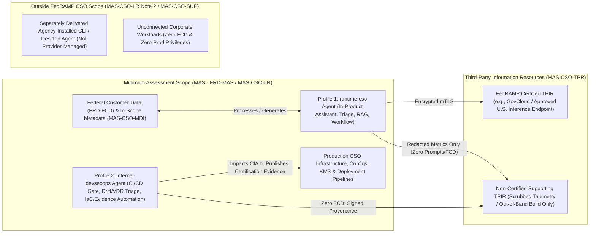
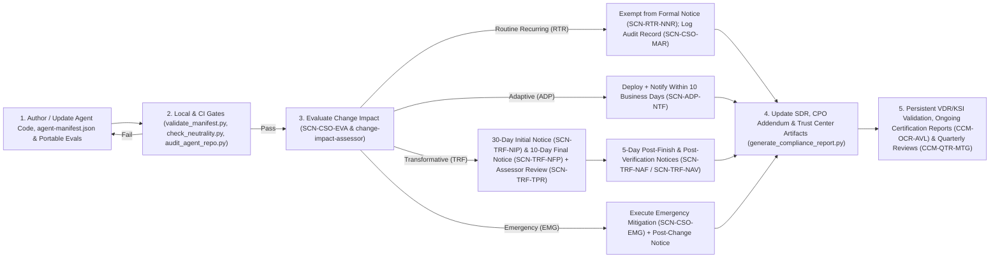

# FedRAMP Class C & Class D AI Agent Engineering Specification

**Specification Version:** `1.0.0`  
**Effective Analysis Date:** `2026-11-19`  
**Regulatory Baseline:** FedRAMP Consolidated Rules for 2026 (`CR-26`, dataset version `2026.11.02.01`, updated `2026-11-02`)  
**Architectural Reference Model:** Coalition for Secure AI (`CoSAI`) Risk Map Agentic Component Model (`ADR-006`, `ADR-030`, `ADR-031`, `ADR-033`)  
**Approved Scope:** FedRAMP **Class C** (`20x` and `Rev5`) and **Class D** (`Rev5` and `20x`-ready for `2027`) across `runtime-cso` and `internal-devsecops` agent profiles

**Companion References:**
- Complete CR-26 Rule, KSI, and Rev5 Control Catalog: [`relevant-rulesets.md`](relevant-rulesets.md)
- Controlled FedRAMP Terminology (`81` FRD Definitions): [`compliance/frd-glossary.md`](compliance/frd-glossary.md)
- Verbatim CoSAI-to-CR-26 Crosswalk: [`compliance/cosai-crosswalk.md`](compliance/cosai-crosswalk.md) & [`compliance/cosai-crosswalk.json`](compliance/cosai-crosswalk.json)
- Empirical FedRAMP Marketplace Class C/D & AI Boundary Analysis: [`compliance/marketplace-class-cd-analysis.md`](compliance/marketplace-class-cd-analysis.md)
- Multi-Model Engineering & Compliance Routing Playbook: [`docs/model-routing-playbook.md`](docs/model-routing-playbook.md)
- Step-by-Step Team Onboarding Guide: [`docs/getting-started.md`](docs/getting-started.md)

---

## 1. Purpose, Regulatory Timeline & Normative Conventions

Engineering teams across the enterprise build autonomous and semi-autonomous AI agents in diverse languages and runtimes (Python, TypeScript, Go, Java, Rust). Without a shared architectural contract and automated verification gate, ad-hoc agent designs routinely break FedRAMP compliance boundaries through unvetted model-inference egress, unencrypted or over-privileged credentials, unsandboxed Model Context Protocol (`MCP`) tool execution, or raw prompt leakage into external observability platforms.

This specification defines the **normative, language-agnostic engineering requirements** that every FedRAMP Class C and Class D AI agent MUST satisfy before deployment. Teams adopt this standard by cloning or branching this repository, declaring their runtime posture in `agent-manifest.json` (validated against [`schemas/agent-manifest.schema.json`](schemas/agent-manifest.schema.json)), enforcing the Policy Enforcement Points (`PEPs`) specified below, and running the zero-dependency Python 3.11+ compliance gates in [`tools/`](tools/).

### 1.1 Imminent Regulatory Deadlines

| Effective Date | Milestone | Governing Authority & Operational Impact |
|---|---|---|
| **`2026-12-07`** *(Grace to `2027-03-07`)* | Mandatory `VDR` & `VER` Enforcement | CISA Binding Operational Directive `26-04` and FedRAMP CR-26 Vulnerability Detection and Response (`VDR`) / Evaluation and Reporting (`VER`) rules take effect (`<= 5` days evaluation for Class C; `<= 2` days for Class D under `VER-TFR-EVU`). |
| **`2027-01-01`** | CR-26 Mandatory Adoption | Mandatory maintenance/obtain cutover for FedRAMP Consolidated Rules for 2026 (`MAS`, `CMU`, `SCN`, `IEC`, `SCG`, `SDR`, `CPO`, `CDS`, `CCM`). |
| **`2027-06-11`** | End of New `Rev5` Certifications | Cutoff for new initial FedRAMP `Rev5` certifications as offerings transition to `20x` (with `20x` Class D targeted via the `2027` Phase 4 Pilot). |

### 1.2 Normative Vocabulary & Zero-Invention Discipline

- Normative keywords **`MUST`**, **`MUST NOT`**, **`SHOULD`**, **`SHOULD NOT`**, and **`MAY`** carry their exact FedRAMP Controlled Definition meanings (`FRD-MST`, `FRD-MNT`, `FRD-SHD`, `FRD-SNT`, `FRD-MAY`). Under `VDR-CSO-FAV` (*Failures Are Vulnerabilities*), any failure to satisfy an applicable `MUST` or `MUST NOT` requirement constitutes an active security vulnerability subject to `VDR`/`VER` tracking.
- **Key Security Indicators (`KSI`)** express outcome-oriented security capabilities for `20x` assessments without RFC-2119 force keywords; automated validation is `MUST` for both Class C and Class D under `FRC-CSX-VVK`.
- **Non-Invention Rule for Pending `20x` Class D Entries:** In CR-26 version `2026.11.02.01`, five `20x` indicators (`KSI-CNA-EIS`, `KSI-MLA-ALA`, `KSI-SVC-PRR`, `KSI-SVC-RUD`, `KSI-SVC-VCM`) and persistent machine-verification rule `VDR-TFR-MVX` omit `varies_by_class.d` (and `SDR-CSX-KMT` notes that `20x` Class D specifics will be finalized during the `2027` Phase 4 Pilot). Neither this specification nor downstream agent documentation invents `20x` Class D text for those six entries; Class D enforcement rests on common `FRR` rules and `Rev5` High `CTL` controls.

---

## 2. Reference Architecture & Topology

### 2.1 End-to-End Agentic Topology (CoSAI ADR-030)

Every compliant agent architecture implements four structural separation rules established in CoSAI `ADR-030`:

1. **Model Artifact Reachability Boundary (`ADR-030 D11`, `D12`):** At runtime, `componentTheModel` is reachable **exclusively** through `componentModelServing` (*Model Serving Infrastructure & Policy Enforcement Point*). Application, agent, and orchestration I/O handlers NEVER wire directly to model weights or bypass `componentModelServing`.
2. **Operator-Individuated Policy Enforcement Points (`ADR-030 D4`, `D14`):** Distinct network egress/ingress PEPs govern the application boundary (`componentApplicationNetworkPolicyEnforcementPoint`), the agent egress boundary (`componentAgentNetworkPolicyEnforcementPoint`), and the external tool zone ingress boundary (`componentToolNetworkPolicyEnforcementPoint`), complemented by an in-flow Layer-7 `componentAuthorizationPolicyEnforcementPoint` before tool execution. No data path may enter the External Tools tier without traversing `componentToolNetworkPolicyEnforcementPoint`.
3. **Code-Ownership Hosting Confinement (`ADR-030 D6`, `D13`):** Both `componentRuntimeHosting` (hosting first-party application, reasoning core, and model serving workloads) and `componentToolHosting` (hosting untrusted or third-party tool/MCP servers) execute inside `componentIsolationRuntime` confinement, never sharing an unisolated host namespace.
4. **Control-Plane-Separated Audit Sink (`ADR-030 D15`):** Every PEP, hosting substrate, and reasoning/serving locus emits structured telemetry to `componentAuditRecordRepository`, administered under a separate control plane with zero delete/modify credentials accessible to runtime workloads.

```mermaid
flowchart TB
    subgraph IdentityPlane["Identity Plane (componentsIdentity - ADR-030 D2, D17)"]
        IdP["componentIdentityProvider (IdP: Class C IAL2/AAL2/FAL2 | Class D IAL3/AAL3/FAL3)"]
        PDP["componentAuthorizationPolicyDecisionPoint (Authz PDP)"]
        FedProxy["componentFederationProxy (RFC 8693 Scoped Token Exchange)"]
        IdP -->|"Subject Attributes & JWE/XML-Enc Assertions"| PDP
        IdP -->|"Upstream Trust"| FedProxy
    end

    subgraph AppTier["Application Core (componentsApplicationCore - ADR-030 D4, D5)"]
        App["componentApplication"]
        AppConsent["componentApplicationConsentSurface (User-Engaged Approval)"]
        AppIn["componentApplicationInputHandling"]
        AppOut["componentApplicationOutputHandling"]
        AppPEP["componentApplicationNetworkPolicyEnforcementPoint (Application Egress PEP)"]
        App --> AppConsent
        AppConsent --> AppIn
        AppOut --> AppPEP
    end

    subgraph AgentTier["Agent Tier (componentsAgent - ADR-030 D4, D5, D8)"]
        AgentPEP["componentAgentNetworkPolicyEnforcementPoint (Agent Egress PEP)"]
        AgentIn["componentAgentInputHandling (Screens Prompts, Context & Tool Metadata)"]
        Reason["componentReasoningCore (Bounded Turns & Tokens)"]
        AgentOut["componentAgentOutputHandling (Sanitizes Output & Redacts External Telemetry)"]
        AgentConsent["componentAgentConsentSurface (Mid-Loop Action Elicitation)"]
        Transport["componentAgentToolTransport (mTLS 1.3 + FIPS Channel)"]
        AppPEP <-->|"Peer Handoff"| AgentPEP
        AgentPEP --> AgentIn
        AgentIn --> Reason
        Reason --> AgentOut
        AgentOut --> AgentConsent
        AgentConsent --> AgentIn
        AgentOut --> AgentPEP
        AgentPEP --> Transport
    end

    subgraph Registries["Infrastructure Registries (componentsRegistries)"]
        ModelReg["componentModelRegistry (Signed Model & Adapter Digests)"]
        ToolReg["componentToolRegistry (Cryptographically Pinned Allowlist)"]
    end

    subgraph ModelZone["Model & Orchestration Tier (componentsModel - ADR-030 D11, D12)"]
        ModelPEP["componentModelServing (Model Serving PEP - Sole Runtime Door)"]
        ModelArtifact["componentTheModel (Model Artifact - D11 Reachability Boundary)"]
        OrchIn["componentOrchestrationInputHandling"]
        OrchOut["componentOrchestrationOutputHandling"]
        RAG["componentRAGContent & componentMemory (Tenant-Isolated)"]
        AgentPEP -->|"Inference Traffic (US Jurisdiction in Class D)"| ModelPEP
        ModelReg -.->|"Pinned Endpoint & Digest Consult"| ModelPEP
        ModelPEP <-->|"Sole Runtime Path"| ModelArtifact
        ModelPEP --> OrchIn
        OrchIn --> RAG
        RAG --> OrchOut
        OrchOut --> ModelPEP
    end

    subgraph ToolZone["External Tool / MCP Zone (componentsExternalTools - ADR-030 D1, D7, D14)"]
        ToolNetPEP["componentToolNetworkPolicyEnforcementPoint (Tool Ingress PEP)"]
        ToolIn["componentToolInputHandling (Schema & Argument Validation)"]
        AuthzPEP["componentAuthorizationPolicyEnforcementPoint (L7 Caller Intersect Agent Scope)"]
        ToolSrv["componentToolServer & componentTools"]
        ToolOut["componentToolOutputHandling (Response Sanitization)"]
        Transport -->|"Mandatory Tool Zone Entry (D14)"| ToolNetPEP
        ToolNetPEP --> ToolIn
        ToolIn --> AuthzPEP
        AuthzPEP --> ToolSrv
        ToolSrv --> ToolOut
        ToolOut --> ToolNetPEP
    end

    subgraph DeploymentPlane["Deployment & Confinement Plane (componentsDeployment - ADR-030 D6, D13, D15)"]
        Iso["componentIsolationRuntime (MicroVM / Enclave Confinement)"]
        RunHost["componentRuntimeHosting (First-Party Workloads)"]
        ToolHost["componentToolHosting (Third-Party Tool Sandbox)"]
        AuditRepo["componentAuditRecordRepository (Control-Plane-Separated WORM Store)"]
        Iso -->|"Contains"| RunHost
        Iso -->|"Contains"| ToolHost
    end

    ToolReg -.->|"Allowed Destination Consult (D14)"| AgentPEP
    PDP -.->|"Policy Verdict"| AppPEP
    PDP -.->|"Policy Verdict"| AgentPEP
    PDP -.->|"Policy Verdict"| ModelPEP
    PDP -.->|"Action Verdict"| AuthzPEP
    FedProxy -.->|"Short-Lived Capability Token"| AgentPEP
    FedProxy -.->|"Token Verification"| ToolNetPEP
    RunHost -.->|"Hosts"| Reason
    RunHost -.->|"Hosts"| ModelPEP
    ToolHost -.->|"Hosts"| ToolSrv
    AgentPEP -->|"Append-Only Audit"| AuditRepo
    ModelPEP -->|"Append-Only Audit"| AuditRepo
    AuthzPEP -->|"Append-Only Audit"| AuditRepo
```



### 2.2 Agent Profile Comparison: `runtime-cso` vs. `internal-devsecops`

This repository standardizes two operational agent profiles (`agent_profile` in `agent-manifest.json`), while explicitly distinguishing out-of-scope agency-installed client software per `MAS-CSO-IIR`:



| Dimension | `runtime-cso` Profile | `internal-devsecops` Profile | Agency-Installed Client Software (`Out of CSO Scope`) |
|---|---|---|---|
| **Definition** | Provider-managed cloud agent handling `Federal Customer Data` (`FRD-FCD`) or sensitive operational metadata. | Provider-operated engineering, security, deployment, or compliance agent whose actions can affect production CSO confidentiality, integrity, or availability (`CIA`). | Software delivered separately for installation on agency-operated endpoints and not run in a shared-responsibility cloud service (`MAS-CSO-IIR` Note 2). |
| **MAS Inclusion (`in_minimum_assessment_scope`)** | **`MUST` be `true`** (`MAS-CSO-IIR`, `MAS-CSO-MDI`). | **`MUST` be `true`** whenever the agent can mutate production state, access production metadata/logs, sign releases, or generate certification evidence; `false` ONLY if wholly unconnected (`MAS-CSO-SUP`). | Excluded from the provider's FedRAMP CSO boundary under the FedRAMP Authorization Act (`MAS-CSO-IIR` Note 2); governed by agency endpoint ATO. |
| **Inference Destination** | FedRAMP-certified `TPIR` at `>=` CSO class or self-hosted inside MAS; U.S. jurisdiction `MUST` for Class D (`CTL.SA.SA-09-05`). | Self-hosted in MAS or approved `TPIR` under `MAS-CSO-TPR`; `MUST NOT` transmit production secrets, vulnerability details (`VER-RPT-NID`), or `FRD-FCD` to uncertified public LLM APIs. | Configured by the customer agency. |
| **Identity Assurance** | Agency tenant SSO at `IAL2/AAL2/FAL2` (Class C) or `IAL3/AAL3/FAL3` (Class D) (`CTL.IA.IA-05`). | Provider privileged operator SSO at `IAL2/AAL2/FAL2` (Class C) or `IAL3/AAL3/FAL3` (Class D) + workload identity (`KSI-IAM-SNU`, `KSI-IAM-JIT`). | N/A to provider CSO. |

### 2.3 Agent Change & Release Compliance Lifecycle



---

## 3. Normative Technical Requirements by Security Domain

### 3.1 Boundary, Minimum Assessment Scope (`MAS`) & `TPIR` Governance

**Governing Authorities:** `MAS-CSO-IIR`, `MAS-CSO-FLO`, `MAS-CSO-MDI`, `MAS-CSO-SUP`, `MAS-CSO-TPR`, `FRC-CSX-MAS`; `CTL.CM.CM-08`, `CTL.AC.AC-20`, `CTL.SA.SA-09-02`; CoSAI `controlAgentInventoryManagement`, `controlOrchestratorAndRouteIntegrity`.

1. **Mandatory MAS Inclusion:** Any agent service, orchestrator, vector database, memory store, or prompt/telemetry pipeline that handles `Federal Customer Data` (`FRD-FCD`) or metadata likely to impact the confidentiality, integrity, or availability of `FRD-FCD` **MUST** set `fedramp.in_minimum_assessment_scope: true` (`MAS-CSO-IIR`, `MAS-CSO-MDI`).
2. **Application Layer Inclusion (`20x`):** For `20x` offerings, user-facing agent interfaces and API gateways **SHOULD** reside inside the Minimum Assessment Scope (`FRC-CSX-MAS`).
3. **Model Artifact Reachability Enforcement:** Agents **MUST** set `model_serving.model_reachability_pep: true`, routing 100% of runtime inference traffic through `componentModelServing` (`ADR-030 D11/D12`), which enforces model digest pinning against `componentModelRegistry`, tenant rate limits, and destination allowlists.
4. **Third-Party Information Resource (`TPIR`) Governance (`MAS-CSO-TPR`):**
   - Every external cloud substrate, managed LLM inference endpoint, hosted vector index, external MCP server, observability sink, or CI/CD service outside the CSO's own MAS **MUST** be inventoried in `agent-manifest.json` (`tpirs[]`) and [`schemas/tpir-register.schema.json`](schemas/tpir-register.schema.json), documenting usage, justification, mitigation measures, and compensating controls.
   - **Inference Destination Rule:** Any external inference `TPIR` processing unredacted `FRD-FCD` **MUST** hold an active FedRAMP Certification (`certified: true` with a valid `fedramp_package_id`, e.g., `F1603047866` or approved U.S. Data Zone scope under `F1209051525`) at an assurance level commensurate with Class C or Class D, with contractual and technical **zero-data-retention / zero-training** enforcement.
   - **Non-Certified `TPIR` Restriction:** Non-certified `TPIRs` (`certified: false`, `fedramp_package_id: null`) **MUST NOT** receive `FRD-FCD`, unredacted prompts/completions, cryptographic keys, or exploitable vulnerability details (`VER-RPT-NID`), and **MUST** declare non-empty boundary mitigations.

### 3.2 Cryptography & FIPS 140-3 Validation (`Class C` vs. `Class D`)

**Governing Authorities:** `CMU-CSO-CMD`, `CMU-CSO-UVM`, `CMU-CSO-CAT`, `CTL.SC.SC-13`, `KSI-SVC-ASM`, `KSI-SVC-SIN`, `KSI-SVC-VCM`; CoSAI `controlInterComponentTransportSecurity`, `controlModelAndDataIntegrityManagement`.

| Requirement | Class C (`20x` + `Rev5`) | Class D (`Rev5` + `20x`-Ready) | Manifest Enforcement |
|---|---|---|---|
| **Cryptographic Module Inventory (`CMU-CSO-CMD`)** | **`MUST`** document every cryptographic module protecting `FRD-FCD` with CMVP certificate ID or update-stream status. | **`MUST`** document every cryptographic module protecting `FRD-FCD` with active CMVP certificate ID. | `cryptography.modules` non-empty (`ERROR` if empty). |
| **Active CMVP Validation (`CMU-CSO-UVM`)** | **`SHOULD`** use active CMVP FIPS-validated modules (or update streams). If `false`, **MUST** record senior-official risk rationale in the `SDR` (`SDR-CSO-FRR`). | **`MUST`** use active CMVP FIPS-validated cryptographic modules (`FIPS 140-3` active or CMVP-authorized transition). | Class C: `WARNING` if `false`; Class D: **hard `ERROR`** if `false`. |
| **Inter-Component Transport (`CTL.SC.SC-13`)** | Mutual TLS (`mTLS` 1.3 preferred, 1.2 minimum) across Application PEP, Agent Egress PEP, Model Serving PEP, and MCP Tool Transport—including `localhost` sidecars. | Identical `mTLS` topology terminated **exclusively** by active FIPS-validated cryptographic modules. | `cryptography.fips_140_3_validated_modules` + `modules[].purpose`. |
| **Tenant Cryptographic Config (`CMU-CSO-CAT`)** | **`SHOULD`** configure agency tenants so FIPS-compliant cryptography is active by default without custom agency intervention. | **`SHOULD`** (and operationally enforced via `SCG-CSO-SDF`) lock FIPS mode on for all Class D tenants. | Documented in `templates/SCG-agent-secure-config.md`. |

> [!NOTE]
> `KSI-SVC-VCM` (*Validating Communications*) defines `varies_by_class` for `b` and `c` only in CR-26 `2026.11.02.01`. Class D transport validation is normatively enforced via `CMU-CSO-UVM` (`MUST`), `CTL.SC.SC-13`, and `CTL.SC.SC-07`.

### 3.3 Identity, SSO, Delegation & Confused-Deputy Prevention

**Governing Authorities:** `CTL.IA.IA-02`, `CTL.IA.IA-02-01`, `CTL.IA.IA-02-06`, `CTL.IA.IA-04-04`, `CTL.IA.IA-05`, `CTL.AC.AC-06-01`, `CTL.AC.AC-06-02`; `KSI-IAM-AAM`, `KSI-IAM-APM`, `KSI-IAM-ELP`, `KSI-IAM-JIT`, `KSI-IAM-SNU`, `KSI-IAM-SUS`; CoSAI `controlAgentPluginPermissions`, `controlAgentCredentialIsolation`, `controlAgentIntegrityManagement`, `controlComponentIdentityProvenance`.

1. **Digital Identity Assurance Elevation (`CTL.IA.IA-05`):**
   - **Class C Agents:** **`MUST`** enforce NIST Digital Identity Guidelines at least **`IAL2/AAL2/FAL2`** (`identity_access.digital_identity_level` in `["IAL2/AAL2/FAL2", "IAL3/AAL3/FAL3"]`).
   - **Class D Agents:** **`MUST`** enforce NIST Digital Identity Guidelines **`IAL3/AAL3/FAL3`** (phishing-resistant, hardware-backed cryptographic authenticators such as PIV/CAC with biometric/PIN binding and FAL3 holder-of-key/encrypted federated assertions). Configuring `IAL2/AAL2/FAL2` on a Class D manifest is a **hard validation failure**.
2. **End-to-End Encrypted Identity Assertions (`CTL.IA.IA-05`):** Both Class C and Class D agents **`MUST`** encrypt authentication assertions whenever they transit third parties such as user browsers (`identity_access.encrypted_assertions: true`), using **JSON Web Encryption (`JWE`)** for `OIDC` ID tokens or **XML-Encryption** for `SAML` assertions.
3. **No Local Password Bypass (`KSI-IAM-APM`, `CTL.IA.IA-02-01`):** Local password login backdoors for agency tenants or provider administrators **`MUST`** be disabled (`identity_access.local_password_bypass_disabled: true`).
4. **Confused-Deputy & Cross-Tenant Propagation Prevention (`riskAgenticDelegationConfusedDeputy`, `riskCrossTenantCredentialPropagation`):**
   - Agents **`MUST NOT`** invoke tools or downstream data stores using ambient, static, multi-tenant service-role credentials.
   - At every delegation boundary (`componentFederationProxy` and `componentAuthorizationPolicyEnforcementPoint`), the runtime **`MUST`** perform scoped token exchange (e.g., `RFC 8693` OAuth 2.0 Token Exchange) that narrows effective permissions to:
     $$\text{Effective Scope} = \text{Caller Principal Authority} \cap \text{Registered Agent Capability Allowlist} \cap \text{Tenant Boundary}$$
   - Delegated tokens **`MUST`** carry explicit `aud` (target tool server), `sub` (originating human or workload), `act` (acting agent chain for non-repudiable delegation lineage), `tenant_id`, and bounded short lifetimes (`TTL <= 300s` recommended), bound to the transport channel where supported.
5. **Cryptographic Workload Identity Binding (`riskStaleAgentIdentityBinding`, `controlAgentIntegrityManagement`):** Non-user agent credentials (`KSI-IAM-SNU`) **`MUST`** bind to the registered `agent_id` and underlying model/container digest, automatically revoking credentials when an agent is suspended, decommissioned, or swapped to a different model artifact.

### 3.4 Data, Processing & Inference Residency (`CTL.SA.SA-09-05`)

**Governing Authorities:** `CTL.SA.SA-09-05`, `MAS-CSO-FLO`, `MAS-CSO-TPR`; CoSAI `controlOrchestratorAndRouteIntegrity`, `controlUserDataManagement`.

- **Class C (`CTL.SA.SA-09-05.varies_by_class.c`):** Providers **`MUST`** control and document the location of `information processing, information or data, AND system services` for `all federal customer data` (`data_classification.residency_boundary`).
- **Class D (`CTL.SA.SA-09-05.varies_by_class.d`):** Providers **`MUST`** restrict `information processing, information or data, AND system services` for `all federal customer data` **exclusively** to **`U.S./U.S. Territories or geographic locations where there is U.S. jurisdiction`**.
  - For Class D agents handling `FRD-FCD`, `model_serving.us_jurisdiction_only` **`MUST`** be `true` and `data_classification.residency_boundary` **`MUST`** designate U.S. sovereign/U.S.-jurisdiction regions (e.g., AWS GovCloud US, Azure Government, or verified U.S.-jurisdiction-only commercial enclaves staffed and controlled within U.S. jurisdiction).
  - **Failover & Cache Invariant:** Cross-region inference failover routes, semantic/KV prompt caches (`componentMemory`), vector embeddings (`componentRAGContent`), and backup snapshots (`KSI-RPL-ABO`) **`MUST`** fail closed rather than failing over to non-U.S. endpoints.

### 3.5 Tool/`MCP` Isolation, Sanitization, Execution Bounds & Dual Consent Surfaces

**Governing Authorities:** `SCG-CSO-SDF`, `SCG-CSO-RSC`, `SCG-CSO-AUP`, `CTL.AC.AC-06-08`, `CTL.CM.CM-11`, `CTL.SC.SC-07`, `CTL.SI.SI-04`; `KSI-CNA-DFP`, `KSI-CNA-MAT`, `KSI-CNA-OFA`, `KSI-CNA-RNT`; CoSAI `ADR-030 D1/D5/D6/D7/D13/D14`.

1. **Pinned Tool Registry & Default-Deny Egress (`tool_registry_allowlist: true`, `network_egress_pep: true`):**
   - All tools permitted for an agent **`MUST`** be explicitly listed in `tool_boundaries.allowed_tools` (`CTL.AC.AC-06-08`) and registered with schema/endpoint digests in `componentToolRegistry` (`controlToolRegistryAndDiscoveryIntegrity`, mitigating `riskToolRegistryTampering`, `riskToolSourceProvenance`, and `riskZombieShadowMCPServers`).
   - `componentAgentNetworkPolicyEnforcementPoint` **`MUST`** consult `componentToolRegistry` at connection admission (`ADR-030 D14`) and drop connections to any unenumerated host, IP, or port.
2. **Third-Party Tool Sandbox Confinement (`third_party_tool_isolation: true`):**
   - Third-party MCP servers, plugin backends, and code-execution tools **`MUST`** execute on `componentToolHosting` inside `componentIsolationRuntime` (e.g., rootless MicroVMs, gVisor, Wasm sandboxes, or dedicated isolated pods with read-only root filesystems, dropped Linux capabilities, and no host-network or metadata-service access).
3. **Four-Gate Content Validation (`componentAgentInputHandling`, `componentToolInputHandling`, `componentToolOutputHandling`, `componentAgentOutputHandling`):**
   - Remote tool descriptors (`tools/list` metadata) and tool execution responses **`MUST`** pass through `componentToolOutputHandling` and `componentAgentInputHandling` before reaching `componentReasoningCore` (`ADR-030 D8`).
   - Tool arguments **`MUST`** be validated against strict typed JSON Schemas at `componentToolInputHandling` before reaching `componentAuthorizationPolicyEnforcementPoint`.
4. **Deterministic Execution Bounds (`controlAgentExecutionBounds`):**
   - Orchestration/reasoning loops **`MUST`** enforce hard `max_turns` ceilings, per-session tool-invocation budgets, wall-clock timeouts, context-window saturation guards, and repeated-call loop circuit breakers (`KSI-CNA-OFA`, mitigating `riskRunawayAgentToolLoops` and `riskEconomicDenialOfWallet`).
5. **Dual Consent Surfaces (`consent_surface_dual_mode: true`, `ADR-030 D5`):**
   - **Application Consent Surface (`componentApplicationConsentSurface`):** Captures upfront user intent and scope approval while the user is actively engaged in the host application.
   - **Agent Consent Elicitation Surface (`componentAgentConsentSurface`):** Pauses mid-loop autonomous execution before any state-mutating, destructive, cross-boundary, or irreversible action. To prevent consent habituation/fatigue, routine read-only lookups within pre-approved scope DO NOT trigger mid-loop prompts; consequential actions render sanitized parameters and cryptographically bind the human approval digest to the exact tool name and canonicalized arguments (preventing replay or parameter substitution).

### 3.6 Tamper-Evident Audit Logging & Telemetry Redaction

**Governing Authorities:** `MAS-CSO-MDI`, `SCN-CSO-MAR`, `CDS-TRC-ACL`, `CTL.AU.AU-06`, `CTL.AU.AU-06-05`, `CTL.AU.AU-10`, `CTL.AU.AU-12`, NIST SP 800-53 Rev. 5 `AU-9(2)`/`AU-9(4)`/`AU-9(6)`; `KSI-MLA-LET`, `KSI-MLA-OSM`, `KSI-MLA-RVL`, `KSI-MLA-ALA` *(Class B/C in `2026.11.02.01`)*; CoSAI `componentAuditRecordRepository` (`ADR-030 D15`), `controlAgentObservability`, `controlRuntimePrivacyEnhancingTechnologies`.

1. **Control-Plane-Separated WORM Repository (`tamper_evident_audit_repo: true`, `audit_control_plane_separated: true`):**
   - Audit records **`MUST`** stream append-only to `componentAuditRecordRepository` (e.g., S3 Object Lock Compliance Mode / immutable log ledger) administered in a separate IAM/account control plane where runtime agent workloads hold write-only or out-of-band collector permissions and **zero** modify/delete permissions.
2. **Required Agent Telemetry Event Schema (`KSI-MLA-LET`, `CTL.AU.AU-12`):**
   - Every inference call, delegation token exchange, PEP allow/deny decision, consent elicitation verdict, and tool invocation **`MUST`** emit a correlated event containing: timestamp (UTC ISO-8601), `agent_id`, `version`, `tenant_id`, human/service `sub`, delegation chain `act`, model/adapter SHA-256 digest, tool identifier, PEP policy verdict, and cryptographic hash chain/digest.
3. **Mandatory External Telemetry Redaction & Deterministic Telemetry Invariant (`prompt_response_redacted_from_external_telemetry: true`, `MAS-CSO-MDI`, `FRD-DTM`):**
   - Raw user prompts, model completions, RAG chunks, and `FRD-FCD` **`MUST`** be scrubbed/redacted prior to export to any external observability, APM, or metrics `TPIR`. Only authoritative, scrubbed operational metrics (latency, token counts, HTTP/RPC status codes, PEP block counters) may leave the MAS boundary toward non-certified monitoring `TPIRs`.
   - **Prohibition on Generative AI for Deterministic Telemetry (`FRD-DTM`):** Per `FRD-DTM`, probabilistic inferences, generative outputs, or predictive assessments produced by generative transformer models do NOT constitute a factual record of system state and **`MUST NOT`** be used to generate deterministic compliance or KSI telemetry (`FRC-CSX-VVK`). Deterministic telemetry **`MUST`** come directly from authoritative system sources and deterministic validators (`tools/*.py`).

### 3.7 Vulnerability Detection, Evaluation & Incident Response (`VDR`, `VER`, `IEC`)

**Governing Authorities:** `VDR-CSO-DET`, `VDR-CSO-FAV`, `VDR-CSO-RES`, `VDR-TFR-KEV`, `VDR-TFR-MVF`, `VDR-TFR-MVX`, `VDR-TFR-PDD`, `VDR-TFR-PVR`; `VER-EVA-AIA`, `VER-EVA-EIR`, `VER-EVA-ELX`, `VER-EVA-EPA`, `VER-TFR-EVU`, `VER-TFR-IRI`, `VER-TFR-NRI`; `IEC-CSO-EFR`, `IEC-CSO-DPR`, `IEC-CSO-EFI`, `IEC-CSO-IIR`, `IEC-CSO-OIR`, `IEC-CSO-FIR`; `CTL.IR.IR-04`, `CTL.IR.IR-06`, `CTL.IR.IR-09`, `CTL.RA.RA-05`, `CTL.SI.SI-02`.

| Operational Requirement | Class C (`20x` + `Rev5`) | Class D (`Rev5` + `20x`-Ready) | Governing Rule ID |
|---|---|---|---|
| **Persistent Machine Verification** | `20x`: **`MUST`** every **`3` days** (`VDR-TFR-MVX.c`)<br>`Rev5`: **`MUST`** every **`1` month** (`VDR-TFR-MVF.c`) | `Rev5`: **`MUST`** every **`1` month** (`VDR-TFR-MVF.d`)<br>`20x`: *Not defined in `2026.11.02.01` (`VDR-TFR-MVX` omits `d`)* | `VDR-TFR-MVX`, `VDR-TFR-MVF` |
| **Vulnerability Evaluation SLA (`vdr_triage_sla_days`)** | **`SHOULD`** evaluate all detected vulnerabilities within **`<= 5` days** (enforced as repo manifest cap `<= 5`). | **`SHOULD`** evaluate all detected vulnerabilities within **`<= 2` days** (enforced as repo manifest cap `<= 2`). | `VER-TFR-EVU` |
| **PAIN=5 Remediation Target (`IRV + LEV`)** | **`2` days** (`nirv_lev`: `4` days; `nlev`: `16` days) | **`12` hours** (`nirv_lev`: `1` day; `nlev`: `8` days) | `VDR-TFR-PVR` |
| **PAIN=4 Remediation Target (`IRV + LEV`)** | **`4` days** (`nirv_lev`: `8` days; `nlev`: `64` days) | **`2` days** (`nirv_lev`: `8` days; `nlev`: `32` days) | `VDR-TFR-PVR` |
| **Internet-Reachable LEV (`PAIN > 3`) Incident Escalation** | **`SHOULD`** treat as FedRAMP Reportable Incident until `<= N3` | **`SHOULD`** treat as FedRAMP Reportable Incident until `<= N3` | `VER-TFR-IRI` |
| **Non-Internet-Reachable LEV (`PAIN = 5`) Incident Escalation** | **`MAY`** treat as FedRAMP Reportable Incident until `<= N4` | **`SHOULD`** treat as FedRAMP Reportable Incident until `<= N4` | `VER-TFR-NRI` |
| **Default Incident PAIN Rating** | **`MUST`** assume **`PAIN = 5`** unless promptly rated under `IEC-CSO-EFI` | **`MUST`** assume **`PAIN = 5`** unless promptly rated under `IEC-CSO-EFI` | `IEC-CSO-DPR` |

**Agent-Specific Containment & Kill-Switch Mandate:** Every deployed agent **`MUST`** implement an immediate operator kill-switch (documented in [`templates/IEC-incident-runbook.md`](templates/IEC-incident-runbook.md)) capable of: (1) revoking the agent's workload identity and active RFC 8693 capability tokens within `< 60` seconds, (2) flipping `componentAgentNetworkPolicyEnforcementPoint` and `componentAuthorizationPolicyEnforcementPoint` to deny-all for the affected `agent_id` or tool server, and (3) preserving forensic state in `componentAuditRecordRepository` for `IEC-CSO-IIR` / `IEC-CSO-OIR` / `IEC-CSO-FIR` reporting.

### 3.8 Configuration Management, `SCG`, Continuous Monitoring (`CCM`/`SDR`/`CPO`/`CDS`) & Portable Evals

**Governing Authorities:** `SCG-CSO-SDF`, `SCG-CSO-RSC`, `SCG-CSO-AUP`, `SCG-ENH-MRG`; `SCN-CSO-EVA`, `SCN-CSO-MAR`, `SCN-CSO-HRM`, `SCN-ADP-NTF`, `SCN-TRF-NIP`, `SCN-RTR-NNR`; `SDR-CSO-FRR`, `SDR-CSX-KSI`, `SDR-CSX-KMT`; `CPO-CSO-OVR`, `CDS-CSO-UTC`, `CDS-CSO-PSM`; `CCM-OCR-AVL`, `CCM-QTR-MTG`; CoSAI `ADR-033 D6/D7`.

1. **Secure Defaults & Machine-Readable Guidance (`SCG`):** Agents **`SHOULD`** ship with secure defaults enabled out of the box (`SCG-CSO-SDF`—FIPS TLS on, default-deny tool egress, dual consent on, external prompt telemetry off) and **`MUST`** supply customer configuration and acceptable-use instructions (`SCG-CSO-RSC`, `SCG-CSO-AUP`) using [`templates/SCG-agent-secure-config.md`](templates/SCG-agent-secure-config.md).
2. **Dual Human + JSON Significant Change Notifications (`SCN-CSO-EVA`, `SCN-CSO-HRM`):** Every candidate change to model family/weights, `TPIR` endpoints, cryptographic modules, `PEPs`, or `allowed_tools` **`MUST`** be evaluated before release and recorded in both Markdown ([`templates/SCN-change-notice.md`](templates/SCN-change-notice.md)) and JSON ([`schemas/scn-record.schema.json`](schemas/scn-record.schema.json)), retaining 12 months of history (`SCN-CSO-HIS`).
3. **Per-Service Certification Materials (`CDS-CSO-PSM`):**
   - **Class C:** **`MAY`** supply per-service FedRAMP Certification materials (`lifecycle.per_service_certification_artifacts: false` or `true`).
   - **Class D:** **`MUST`** supply per-service FedRAMP Certification materials (`lifecycle.per_service_certification_artifacts: true` enforced as a hard validation gate).
4. **Security Decision Record & `20x` Metrics (`SDR-CSO-FRR`, `SDR-CSX-KMT`):** Architectural trade-offs, Class C non-FIPS rationales (if any), and KSI automation cycles **`MUST`** be maintained in [`templates/SDR-agent-record.md`](templates/SDR-agent-record.md) and [`schemas/sdr-agent-addendum.schema.json`](schemas/sdr-agent-addendum.schema.json). Under `SDR-CSX-KMT`, `20x` Class C offerings **`MUST`** include 30-day summaries, 1-year summaries, and daily persistent validation metrics; `20x` Class D specifics are governed by the `2027` Phase 4 Pilot.
5. **Vendor-Neutral Canonical Agents, Skills & Portable Evals (`CoSAI ADR-006`, `ADR-031 D6`, `ADR-033 D2a/D6/D7`):**
   - All reusable compliance sub-agents in [`agents/`](agents/) and skills in [`skills/`](skills/) **`MUST`** remain strictly vendor-neutral (zero AI vendor, product, harness, CLI, or model identifiers) and pass `python3 tools/check_neutrality.py agents skills`.
   - Every agent manifest **`MUST`** declare non-empty `lifecycle.portable_eval_paths` pointing to runtime-independent evaluation suites (`evals/evals.json` + clean non-leaking `evals/fixtures/` per `ADR-033 D7d`).

---

## 4. Polyglot Clone/Branch Implementation Blueprint

This repository is intentionally **runtime-language agnostic**. Whether an engineering team builds its production agent in Python, TypeScript/Node.js, Go, Java, or Rust, the compliance contract is identical: the repository root carries `agent-manifest.json`, compliance evidence templates, vendor-neutral `agents/` and `skills/`, and the zero-dependency Python 3.11+ verification CLIs in `tools/`.

### 4.1 Recommended Branched Team Repository Layout

```text
<your-agent-repo>/                        # Cloned or branched from fedramp-agent
├── agent-manifest.json                   # Copy from templates/agent-manifest.example.class-{c,d}.json
├── schemas/                              # Unmodified canonical JSON Schemas (synced from upstream)
├── tools/                                # Unmodified zero-dependency Python 3.11+ validators
├── agents/                               # Canonical vendor-neutral compliance sub-agents
├── skills/                               # Canonical Agent Skills + portable evals/fixtures
├── compliance-artifacts/                 # Populated per-agent MAS, SDR, SCG, SCN, VDR, IEC, CPO files
└── src/                                  # Team's runtime code in ANY language (Python, TS, Go, Java, Rust)
    ├── pep/                              # Model Serving PEP, Agent Egress PEP & Authz PEP adapters
    ├── identity/                         # OIDC JWE / SAML XML-Enc + RFC 8693 token exchange
    ├── tools/                            # Allowlisted MCP/tool handlers running in Isolation Runtime
    └── telemetry/                        # Prompt/FCD redactor + WORM Audit Record emitter
```

### 4.2 Polyglot Runtime Integration Matrix

| Compliance Surface | Python 3.11+ Runtime | TypeScript / Node.js Runtime | Go Runtime | Java / JVM Runtime |
|---|---|---|---|---|
| **FIPS 140-3 Cryptography (`CMU-CSO-UVM`)** | Python linked against OpenSSL 3 FIPS provider / AWS-LC-FIPS (`ssl.FIPS_mode()`) | Node.js built with `--enable-fips` / `--force-fips` backed by OpenSSL FIPS module | `GOEXPERIMENT=boringcrypto` (`crypto/tls/fipsonly`) or Microsoft/RedHat FIPS Go toolchain | BouncyCastle FIPS (`BC-FIPS`) or WolfCrypt JNI CMVP-validated provider |
| **Encrypted SSO & Token Exchange (`CTL.IA.IA-05`)** | JWE ID-token decryption + RFC 8693 capability token minting via FIPS crypto backend | `jose` (backed by Node FIPS `crypto`) validating `JWE` + `aud`/`act`/`tenant_id` claims | `go-jose` over BoringCrypto verifying JWE + mTLS client certs (`RFC 8705`) | Nimbus JOSE + JWT over `BC-FIPS` enforcing `IAL3/AAL3/FAL3` ACR claims |
| **Egress & Model Serving PEPs (`ADR-030 D4, D12, D14`)** | Envoy FIPS sidecar + Python L7 `AuthorizationPEP` middleware reading `agent-manifest.json` | Envoy FIPS sidecar + TypeScript JSON Schema + `AuthorizationPEP` interceptor | Envoy FIPS sidecar + Go `net/http` / gRPC interceptor enforcing `allowed_tools` | Envoy FIPS sidecar + Spring Security / Envoy ext_authz filter |
| **Telemetry Redaction (`MAS-CSO-MDI`)** | OpenTelemetry Python processor stripping `gen_ai.prompt` / `gen_ai.completion` before export | OpenTelemetry JS SpanProcessor scrubbing prompt/completion attributes pre-export | OpenTelemetry Go Collector `transform`/`redaction` processor inside MAS | OpenTelemetry Java instrumentation with custom `SpanExporter` PII/FCD scrubber |

### 4.3 Mandatory Pre-Commit & CI Verification Commands

Every developer workstation and pull-request pipeline MUST execute the four canonical checks before merge (configured automatically in [`.pre-commit-config.yaml`](.pre-commit-config.yaml) and [`.github/workflows/fedramp-agent-compliance.yml`](.github/workflows/fedramp-agent-compliance.yml)):

```bash
# 1. Validate agent-manifest.json against schema and Class C / Class D semantic CR-26 rules
python3 tools/validate_manifest.py agent-manifest.json

# 2. Verify strict CoSAI ADR-033 vendor-neutrality & Agent Skills frontmatter/evals on agents/ and skills/
python3 tools/check_neutrality.py agents skills

# 3. Run whole-repository structural, neutrality, and portable-eval path audit
python3 tools/audit_agent_repo.py --repo . --manifest agent-manifest.json

# 4. Generate dual Markdown + JSON SDR & compliance evidence bundle for Trust Center / CCM OCR
python3 tools/generate_compliance_report.py \
  --manifest agent-manifest.json \
  --md-out compliance-report.md \
  --json-out compliance-report.json
```
